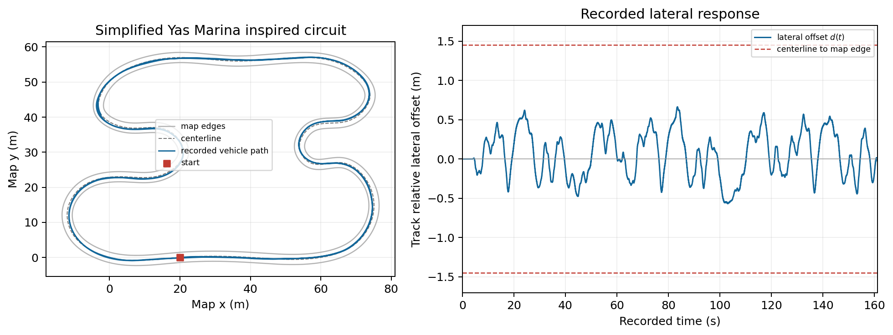

# RMPC F1TENTH: simulation and reproducible evaluation

**Maintainer and paper author:** Kaveh Hooshmandi, Arak University of Technology, [k.hooshmandi@arakut.ac.ir](mailto:k.hooshmandi@arakut.ac.ir).

This repository packages [IndraNeel Mulakaloori's RMPC F1TENTH simulation](https://github.com/IndraNeelMulakaloori/rmpc-simulation) with a Docker/ROS 2 workflow, an original simplified circuit inspired by Yas Marina, recorded data, a 100-trial controlled comparison with Pure Pursuit, and a draft JAMRIS manuscript. The randomized MPC solver is by Arun Muraleedharan. See [NOTICE.md](NOTICE.md) and the licenses before reuse.



The circuit is an original design inspired by Yas Marina, not official track geometry. The lateral value in the plot is signed **Frenet offset from the centerline**, not global map y.

## Run everything from one terminal

With the project Docker image already built, open a desktop terminal in this repository:

```bash
./run.sh launch f1
```

This ROS 2 launch starts the F1TENTH simulator, GPU RMPC controller, map server, Foxglove bridge, and RViz. Press **Ctrl+C** to stop the launched processes. The Docker service stays available; use `./run.sh down` when finished.

```bash
./run.sh launch f1 --no-rviz  # omit RViz
./run.sh launch f1 --record   # also save odometry and drive to a ROS bag
./run.sh launch clear         # original IMS track
./run.sh launch obstacles     # IMS with obstacles
```

The `--record` option saves a new UTC-stamped directory under `telemetry/`. `launch/all_in_one.launch.py` combines the ROS components. The commands were tested on this workstation with an RTX 3050; a short recorded run produced a valid bag with both requested topics.

## Prepare a new machine

The tested setup uses Linux with an X11 desktop, Docker Engine and Compose, an NVIDIA GPU with its host driver and NVIDIA Container Toolkit, and the `osrf/ros:humble-desktop-full` base image. ROS Humble and CUDA 12.4 are installed **inside** the project image. Building needs network access to fetch pinned simulator revisions and packages. The Dockerfile currently targets CUDA compute capability **8.6** (RTX 3050); change `CMAKE_CUDA_ARCHITECTURES=86` for another GPU before building.

The build installs dependencies inside a new container image. Obtain any approval required for installation on your machine before running it. Skip the build if `jamris-rmpc-f1tenth:local` is already present.

```bash
./run.sh check
./run.sh build --install-approved
./run.sh launch f1
```

If the ROS base image is absent, fetch it through your approved Docker setup first. `./run.sh check` reports image and GPU availability. After starting the service, `./run.sh verify` checks CUDA, ROS packages, and Python imports.

`compose.local.example.yaml` shows optional `/dev/dri` mappings for this workstation. Copy it to `compose.local.yaml` only if your display needs them. The local override is ignored by Git. The default Compose file uses an NVIDIA GPU reservation without fixed `/dev/dri` device numbers.

## Recorded run and figures

The archived F1-style run is `telemetry/run_20261112_115749/`. Two laps were detected: 63.696 s and 59.412 s; their mean is 61.554 s. Its recorded maximum absolute centerline offset is 0.662 m. This is **one asynchronous ROS run**, not a repeated-trial comparison. [The run report](reports/f1-style-run-summary.md) explains its scope.

After `./run.sh launch f1 --record` and Ctrl+C, use the new bag directory name:

```bash
./run.sh analyze BAG_DIRECTORY f1
./run.sh plot-f1 BAG_DIRECTORY
```

`analyze` writes metrics and general plots to `results/`. `plot-f1` writes the track and lateral-offset figure. `scripts/generate_f1_style_track.py` generates the original circuit; the map and centerline are under `src/rmpc_f1tenth/maps/F1_STYLE/`.

## Controlled comparison

The separate synchronous study evaluates Pure Pursuit and RMPC at 1,000, 2,500, and 5,000 samples on IMS and the new circuit, plus a synthetic low-grip sector. Its 100 archived trial traces are in `experiments/study_v1/` (80 nominal) and `experiments/slippery_v1/` (20 stress). See [the protocol](experiments/README.md) and [the fixed report](experiments/report/summary.md).

To run new trials after starting the container, choose fresh output directory names:

```bash
./run.sh down
./run.sh up
./run.sh benchmark-build
./run.sh benchmark nominal my_nominal_repeat
./run.sh benchmark slippery my_slippery_repeat
./run.sh report
```

`benchmark-build` compiles source already present in the image; it does not install packages. The report command currently reads archived `study_v1` and `slippery_v1`; edit its dataset paths to report newly named repeats. The study's timing covers synchronized solver calls, not ROS scheduling deadlines.

## Paper and repository layout

- [Draft JAMRIS paper PDF](paper/rmpc_f1tenth_jamris.pdf), editable LaTeX source, and figures are in `paper/`.
- `src/rmpc_f1tenth/` holds the upstream ROS controller snapshot and bundled solver, plus local experiment extensions. Its original README remains for provenance.
- `config/`, `launch/`, `scripts/`, and `docker/` hold runtime configuration, one-terminal launch, track and plot scripts, and container build.
- `telemetry/` and `results/` hold archived asynchronous ROS bags and analyses.
- `experiments/` holds controlled study code, traces, summary, and figures.

See [paper/README.md](paper/README.md) to compile the manuscript. It is a draft, not a published JAMRIS article.

## Provenance and licensing

The upstream controller snapshot is `c5c190f3fc0ad4192b1e7c526661184d59230b66e`; bundled solver snapshot is `2c25f4b1f9017951f8df5fc59add0e1ced3c44d6`. Pinned simulator revisions are recorded in `docker/Dockerfile`. Source is principally C++/CUDA, with Python for ROS integration, experiments, track generation, and plots; Bash and YAML support launch and containers.

The upstream ROS package is Apache 2.0. The bundled randomized MPC solver uses **PolyForm Noncommercial 1.0.0** and needs a separate license for commercial use. See [NOTICE.md](NOTICE.md), [upstream package license](src/rmpc_f1tenth/LICENSE), and [solver license](src/rmpc_f1tenth/helper/randomized-mpc/LICENSE.md). Kaveh Hooshmandi is credited for this packaged study, circuit, evaluation, documentation, and manuscript; upstream authorship is retained.
